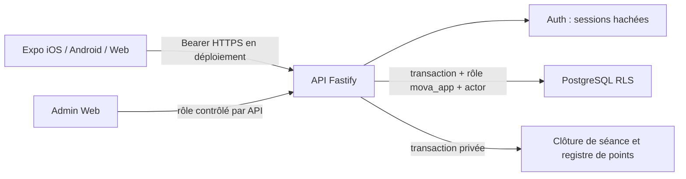

# Architecture et limites

## Structure

`apps/mobile` : Expo SDK 58, React Native 0.88, Expo Router, TanStack Query, SecureStore natif et AsyncStorage pour brouillons. `apps/api` : Fastify 5, Zod 4, pg, crypto Node. `packages/domain` : types, catalogues initiaux, règles déterministes et droits. `database` : migrations transactionnelles. `e2e` : navigateur. `site` : proposition de landing page hors ligne.

## Choix backend

Alternative PostgreSQL/Fastify à Supabase : exécution locale complète sans compte ni clé, tests réels RLS et déploiement ultérieur sur PostgreSQL géré possible. Coût : nous portons l’auth et son durcissement. Ne pas présenter cette version comme équivalente à un service d’identité audité. Supabase Auth reste une migration possible avant ouverture publique. Aucun coût IA, aucun moteur génératif d’entraînement.

## Autorisation

Chaque requête identifie une session par SHA-256 du jeton aléatoire de 256 bits, expiration 7 jours. Les lectures et écritures ordinaires passent dans `tx(...,userId)` : SET LOCAL ROLE et identifiant de sujet, réinitialisés à la fin de transaction. RLS empêche l’accès aux séances/préférences/points/droits d’autrui. Les champs publics du profil sont séparés des identifiants de connexion.

Auth, export, suppression, clôture et administration utilisent des transactions serveur propriétaires explicitement filtrées. Le compte propriétaire local n’est **pas** une configuration de moindre privilège prête à déployer : séparer des pools à permissions minimales, isoler les fonctions sensibles, ajouter MFA admin et revue d’intrusion avant pilote externe. Aucune connexion DB ni clé privilégiée n’est distribuée au mobile.

## Cohérence

Une séance active maximum par compte (index partiel). Le programme est capturé au démarrage : une édition admin ne modifie pas une séance commencée. Séries uniques exercice/index, valeurs bornées. Clôture atomique et verrou utilisateur + séance ; registre unique par workout. Réessayer une clôture ne redonne pas de points. Plafonds calculés en Europe/Paris.

Le brouillon local nécessite une synchronisation explicite. Une panne le conserve. Chaque séance porte une révision : une sauvegarde ou substitution ancienne reçoit 409 et n’écrase rien. L’interface conserve le brouillon, bloque la synchronisation et propose explicitement de charger la version serveur. Il n’y a pas de fusion automatique. L’échéance du repos est conservée dans le brouillon ; la reprise navigateur est vérifiée, pas le kill OS natif. Une nouvelle séance nécessite toujours le serveur.

Fil chronologique paginé par (created_at,id), 20 publications/page ; pas de Realtime ni d’algorithme de recommandation. Pas d’uploads : coût et surface d’attaque contenus. Internationalisation prévue par couche de traduction à extraire ; les textes actuels sont en français dans les composants.

## Accès ordinateur

`npm run desktop` sélectionne uniquement un Docker local (socket Unix ou pipe Windows), prépare une base distincte sur 5434, applique les migrations, construit/cacherise l’interface et sert Web + API sous une même origine sur 127.0.0.1:8080. Le client compilé appelle `/api`. Hôte et origine vérifiés, corps borné à 32 KiB, seuls les exports Web sont servis. Un second lancement reconnaît le serveur existant. `DEMARRER-MOVA.cmd` enveloppe l’installation npm et le lancement sous Windows ; le moteur est testé sous Linux, le .cmd n’a pas été exécuté sous Windows.

La progression du programme suit les séances terminées, sans hausse automatique de charge. Les défis comptent des jours civils distincts dans des périodes de 7 jours à partir de l’inscription. Badges en écriture serveur seulement. Les groupes sont ouverts à l’adhésion, mais leurs posts/commentaires nécessitent une adhésion courante par RLS ; ils ne sont pas mélangés au fil global.

## Distribution personnelle sans dépendances à installer

Un adaptateur SQL commun permet de conserver PostgreSQL serveur et de proposer PostgreSQL WASM/PGlite uniquement pour l’usage local. Les transactions et requêtes hors transaction partagent une file exclusive ; le contexte SET LOCAL ROLE ne peut pas déborder sur la requête d’un autre compte. Les mêmes migrations et tests RLS sont appliqués aux deux moteurs. Le lanceur personnel verrouille le dossier de données, refuse une seconde instance et garde le serveur sur 127.0.0.1. Les données Windows persistent dans LOCALAPPDATA/MOVA-Pilote, hors du dossier de la distribution. Aucun accès PostgreSQL réseau n’est exposé par PGlite.

La distribution ajoute Node.js Windows officiel, épinglé et vérifié par SHA-256. Le moteur serveur, ses dépendances JS/WASM et le Web sont déjà construits : pas de npm ou Docker au premier lancement. PGlite n’est pas le backend de production ; sa sélection est refusée avec NODE_ENV=production et l’API standard limite également ce mode à loopback. Les tests Windows physiques restent nécessaires.
